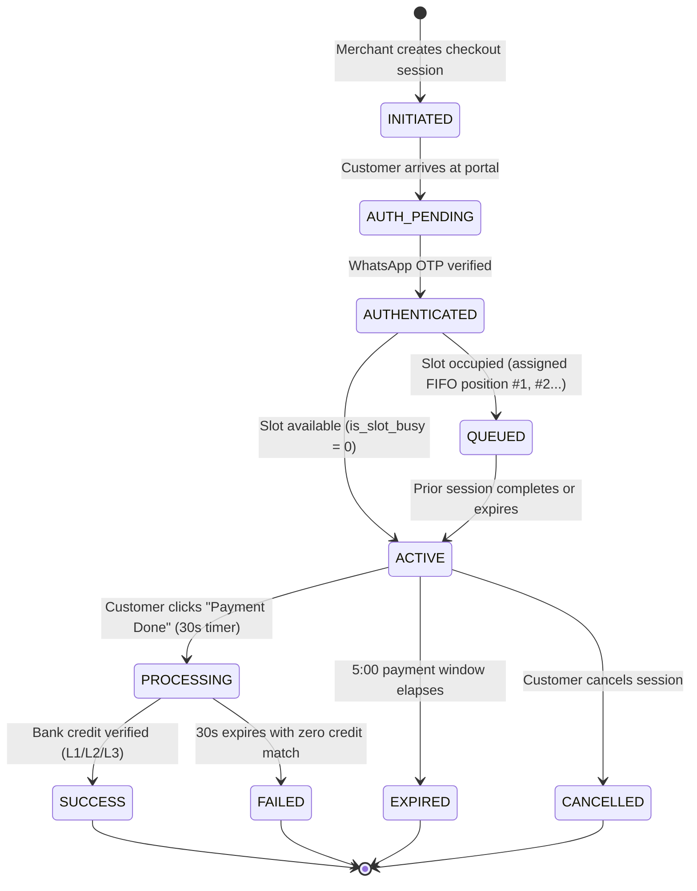
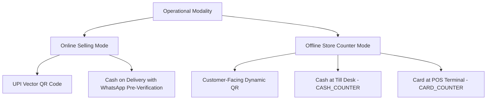

# ARCHITECTURE.md — Canonical System Architecture & Engineering Blueprint

> **YOUPI PG V2**  
> _Sovereign • Self-Hosted • Zero-Fee • Deterministic UPI Payment Gateway Suite_  
> **Architecture Reference:** Production Specification V2  
> **Runtime Target:** Node.js `>= 20.0.0` (ESM Native) • SQLite WAL • Android Kotlin

---

## 1. Executive Summary & Mission Statement

**YOUPI PG** is a sovereign, self-hosted, white-label UPI and multi-modal payment gateway engineered for small-scale merchants, digital creators, and independent businesses in India.

### The Problem It Solves

Traditional Indian payment aggregators (Razorpay, Cashfree, PayU, Paytm) impose:

1. **Aggressive Fees:** 2.0% to 3.0% + 18% GST per transaction.
2. **Delayed Settlements:** T+2 to T+3 business day settlement cycles that choke operational cash flow.
3. **Arbitrary Account Freezes:** Unilateral merchant fund withholding and sudden KYC lockdowns.
4. **Phone Spoofing & Fraud:** Fraudulent orders placed using arbitrary fake phone numbers.

### The YOUPI PG Solution

YOUPI PG eliminates the aggregator intermediary completely:

- **0% Transaction Fees Forever:** Payments are settled directly into the merchant's bank account via peer-to-peer (P2P) UPI rails.
- **Sub-Second Direct Settlement:** Zero holdbacks. Funds land in the merchant's account instantly.
- **Deterministic Bank Observation:** Uses incoming cellular Bank SMS and Gmail notifications to verify payment credits cryptographically without official banking API licenses.
- **Gateway-Owned WhatsApp Authentication:** Verifies buyers via WhatsApp OTP before payment sessions begin, eliminating telephone fraud and invalid numbers.
- **Native Host Execution:** Runs 100% natively on standard Linux and Windows hosts without mandatory Docker containers.

---

## 2. Core Architectural Invariants

Every subsystem in YOUPI PG adheres to eight strict mathematical and operational invariants:

### Invariant 1 — Deterministic Amount-Only Attribution

Payment attribution enforces a strict equality invariant:
$$\text{expected\_amount} == \text{observed\_amount}$$
The system never uses fuzzy matching, probabilistic scoring, or guesswork. A payment session transitions to `SUCCESS` if and only if an observed banking credit exactly matches the session's expected amount on the assigned receiving account.

### Invariant 2 — Exclusive Single-Active-Slot FIFO Queue

Because standard P2P UPI transfers do not carry programmatic merchant transaction IDs in bank SMS alerts, multiple simultaneous transactions of identical amounts on the same VPA would cause attribution ambiguity.

- **The Invariant:** Exactly **ONE** customer payment session can occupy an `ACTIVE` or `PROCESSING` state on a given receiving VPA at any instant.
- **Concurrency Management:** Additional concurrent customers are serialized into a database-backed **FIFO Queue** (`QUEUED` state).
- **Live Promotion:** As soon as the active session succeeds, fails, or expires, the queue arbiter atomically promotes customer #1 to `ACTIVE` and pushes real-time Server-Sent Events (SSE) to update the customer's browser.

### Invariant 3 — Server-Authoritative Decoupled Dual Timers

Timing is governed exclusively by the backend state machine, not client-side JavaScript:

1. **5-Minute Payment Window (`ACTIVE`):** Countdown for the customer to scan the QR code and pay. Remains immutable across browser refreshes and server reboots.
2. **30-Second Verification Window (`PROCESSING`):** Triggered when the customer clicks _"PAYMENT DONE — CHECK MY PAYMENT"_. Decoupled from the 5-minute timer to allow dedicated, high-frequency observer polling.

### Invariant 4 — Pure Vector SVG QR Code Engine

Generates mathematically genuine ISO/IEC 18004 compliant vector SVG QR codes for standard UPI URIs (`upi://pay?pa=...&pn=...&am=...&cu=INR&tn=...`).

- Zero reliance on external Google Charts or third-party image generation APIs.
- Sub-second vector generation that scales crisply to any resolution.

### Invariant 5 — Integer Minor Units (Paise) Arithmetic

All financial calculations, database fields, and API contracts represent money strictly as 64-bit integer minor units (**Paise**).

- ₹1.00 = `100` paise | ₹499.00 = `49900` paise.
- Zero floating-point representation (`0.1 + 0.2` rounding errors are mathematically impossible).

### Invariant 6 — Gateway-Owned Pre-Checkout Identity

The Payment Gateway is the exclusive owner of customer authentication. Merchandising storefronts do not collect or verify customer mobile credentials:

- Customers authenticate via **WhatsApp OTP** powered by Berry Protocol / Baileys multi-device socket.
- Eliminates phone number spoofing, unauthenticated bot sessions, and fake orders before slot allocation.

### Invariant 7 — Pure Source & SQLite WAL Architecture

The active production persistence layer uses Node.js native `node:sqlite` (`DatabaseSync`) operating in Write-Ahead Logging (`WAL`) mode with foreign key constraints enabled (`PRAGMA foreign_keys = ON; PRAGMA busy_timeout = 5000;`).

- Zero external database daemon dependencies.
- Zero Docker container overhead.

### Invariant 8 — Zero-Config Database Auto-Provisioning

On first system boot or after cloning, YOUPI PG guarantees zero-config database provisioning:

- Automatically detects if `data/youpi_pg.sqlite` and core tables exist (`SELECT count(*) FROM sqlite_master WHERE type='table' AND name='merchants'`).
- If missing, creates the parent directory `data/` and runs all schema DDL and baseline seeds idempotently before accepting HTTP traffic.
- Eliminates manual database creation scripts and avoids runtime `SqliteError: no such table` crashes entirely.

---

## 3. High-Level System Architecture

```mermaid
flowchart TB
    subgraph ClientLayer["Client & Storefront Layer"]
        BuyerBrowser["Buyer Browser / Smartphone"]
        MerchantStore["Merchant E-Commerce Storefront"]
        CashierPOS["In-Store Cashier POS Counter"]
    end

    subgraph GatewayFrontend["Gateway Frontend Services"]
        CheckoutPortal["Checkout Portal (Port 7000)<br/>• Dynamic Vector UPI QR<br/>• WhatsApp OTP Modal<br/>• Decoupled Dual Timers<br/>• Mobile Bottom Sheet"]
        AdminDashboard["Merchant Admin Panel (Port 6001)<br/>• White-Label Customizer<br/>• Cashier Till Dock<br/>• Live VPA Slot Hub<br/>• WhatsApp Pairing"]
        DemoStore["YOUPI Showcase Store (Port 5000)<br/>• Enterprise Gateway PDP<br/>• 5 Outcome Demos<br/>• Developer Guide"]
    end

    subgraph CoreBackend["Payment Core REST Engine (Port 6100)"]
        APIEndpoints["REST Routing & SSE Stream Engine"]
        AuthService["WhatsApp Berry Auth Service<br/>(Baileys MD Socket)"]
        QueueEngine["FIFO Slot Arbiter & Queue Engine"]
        TimingEngine["Dual Server-Authoritative Timers"]
        AttributionEngine["Attribution & Deduplication Normalizer"]
        FraudEngine["Browser Fingerprinting & Instant Ban"]
        WebhookEngine["HMAC-SHA256 Webhook Dispatcher"]
    end

    subgraph ObservationMesh["Tri-Channel Banking Observation Mesh"]
        AndroidAPK["Android Observer APK<br/>• SMS_RECEIVED Broadcast<br/>• NotificationListenerService<br/>• Ephemeral QR Pairing<br/>• HMAC-SHA256 Payload Signing"]
        GmailObserver["Gmail Observer (Port 6003)<br/>• Google Cloud OAuth2 API<br/>• Headless Chrome CDP Inbox Poller"]
        SMSObserver["SMS Observer (Port 6002)<br/>• Google Messages Web CDP<br/>• Real-time DOM Text Extractor"]
    end

    subgraph PersistenceLayer["Storage & Supervision"]
        SQLiteDB[("SQLite WAL Database<br/>• data/youpi_pg.sqlite<br/>• Strict Foreign Keys<br/>• Atomic BEGIN/COMMIT")]
        ControlCenter["Control Center (Port 8090)<br/>• Host Process Supervisor<br/>• Health & Log Aggregator"]
    end

    BuyerBrowser -->|Interacts with| CheckoutPortal
    MerchantStore -->|SDK Embed / youpi.js| CheckoutPortal
    CashierPOS -->|Approves Till Cash/Card| AdminDashboard

    CheckoutPortal -->|REST & SSE Stream| APIEndpoints
    AdminDashboard -->|Management API| APIEndpoints
    DemoStore -->|/api/checkout| APIEndpoints

    APIEndpoints --> AuthService
    APIEndpoints --> QueueEngine
    APIEndpoints --> TimingEngine
    APIEndpoints --> AttributionEngine
    APIEndpoints --> FraudEngine

    AuthService --> SQLiteDB
    QueueEngine --> SQLiteDB
    TimingEngine --> SQLiteDB

    AndroidAPK -->|POST /api/v1/observers/sms (Signed)| APIEndpoints
    GmailObserver -->|POST /api/v1/observers/gmail| APIEndpoints
    SMSObserver -->|POST /api/v1/observers/sms| APIEndpoints

    AttributionEngine --> SQLiteDB
    AttributionEngine --> WebhookEngine
    WebhookEngine -->|Signed HMAC Webhook| MerchantStore

    ControlCenter -.->|Supervises PIDs| CoreBackend
    ControlCenter -.->|Supervises PIDs| GatewayFrontend
    ControlCenter -.->|Supervises PIDs| ObservationMesh
```

---

## 4. Subsystem Deep-Dive

### 4.1 Invariant Single-Slot Queue Engine

The queue engine guarantees serialized, non-conflicting payment slot assignment.



#### Atomic Slot Acquisition Logic

```javascript
// packages/core/src/queue-engine.js (Abstracted Schema)
db.exec("BEGIN IMMEDIATE TRANSACTION");
const account = db
  .prepare("SELECT is_slot_busy FROM payment_receiving_accounts WHERE id = ?")
  .get(accountId);

if (!account.is_slot_busy) {
  // Acquire Slot Immediately
  db.prepare(
    "UPDATE payment_receiving_accounts SET is_slot_busy = 1 WHERE id = ?",
  ).run(accountId);
  db.prepare(
    `UPDATE payment_sessions SET 
    status = 'ACTIVE', 
    expires_at = datetime('now', '+5 minutes'),
    activated_at = datetime('now')
    WHERE id = ?`,
  ).run(sessionId);
} else {
  // Enqueue Customer
  const nextPos = db
    .prepare(
      'SELECT COALESCE(MAX(queue_position), 0) + 1 AS pos FROM payment_sessions WHERE receiving_account_id = ? AND status = "QUEUED"',
    )
    .get(accountId).pos;
  db.prepare(
    `UPDATE payment_sessions SET 
    status = 'QUEUED', 
    queue_position = ? 
    WHERE id = ?`,
  ).run(nextPos, sessionId);
}
db.exec("COMMIT");
```

---

### 4.2 Customer Pre-Gateway WhatsApp Authentication Engine

To prevent phone spoofing, bots, and unauthenticated slot exhaustion, customer identity is owned exclusively by the gateway before payment timers begin:

1. **Step 1 — Mobile Input:** Customer enters 10-digit Indian mobile number.
2. **Step 2 — User Check:** Gateway checks `customers` table. If existing, dispatches OTP immediately; if new, captures full name and optional email first.
3. **Step 3 — 6-Digit WhatsApp OTP:** The gateway's Baileys multi-device socket generates a cryptographically secure 6-digit numeric OTP and delivers it directly to the customer's WhatsApp app.
4. **Step 4 — Token Issuance:** Upon verification, the gateway generates an opaque Bearer token (`csess_...`), binds it to `customer_sessions`, and saves the profile in the browser's `localStorage` account switcher (up to 2 remembered profiles).

---

### 4.3 Tri-Channel Banking Observation Engine

YOUPI PG captures bank credit alerts across three redundant layers:

| Layer       | Component                                     | Mechanism                                                                                                                          | Security & Integrity                                                                                                                                                                    |
| :---------- | :-------------------------------------------- | :--------------------------------------------------------------------------------------------------------------------------------- | :-------------------------------------------------------------------------------------------------------------------------------------------------------------------------------------- |
| **Layer 1** | **Native Android APK** (`com.youpi.observer`) | Intercepts cellular SMS (`android.provider.Telephony.SMS_RECEIVED`) and bank push notifications via `NotificationListenerService`. | Paired via ephemeral QR enrollment token. Dispatches payloads to `/api/v1/observers/sms` signed with **HMAC-SHA256(deviceSecret)** and anti-replay timestamp drift protection ($<60$s). |
| **Layer 2** | **Gmail Observer** (Port 6003)                | Google Cloud OAuth2 API polling (`users.messages.list`) or headless CDP Chrome inbox scraper (`@youpi/observer-sdk`).              | Scans incoming bank transaction emails matching regex patterns (HDFC, ICICI, SBI, Axis, Kotak, PNB).                                                                                    |
| **Layer 3** | **SMS Observer** (Port 6002)                  | Headless Chrome CDP automation pairing with Google Messages for Web (`messages.google.com/web`).                                   | Real-time DOM text parsing extracting incoming SMS banking alerts without physical phone cables.                                                                                        |

#### Unified Normalization & Deduplication

Every incoming observation passes through `ObservationNormalizer`:

- Extracts normalized fields: `amountPaise`, `receivingAccount`, `utr`, `senderVpa`, `timestamp`.
- Computes observation cluster fingerprint:
  $$\text{hash} = \text{SHA-256}(\text{receivingAccount} + \text{amountPaise} + \text{utr} + \text{timeBucket})$$
- Identical notifications from multiple channels (e.g., Bank SMS + Push Notification + Gmail Alert) are deduplicated; the first confirms the payment, while redundant alerts increment the verification tier:
  - **L1 (Single Channel Verified):** Transition to `SUCCESS` immediately.
  - **L2 (Dual Channel Verified):** Confirmed across 2 distinct observers.
  - **L3 (Triple Channel Verified):** Confirmed across SMS, Push Notification, and Gmail.

---

### 4.4 Dual Operational Modalities



1. **Online Selling Mode:**
   - Exposes **UPI QR** and **Cash on Delivery (COD)**.
   - Decoupled COD timer prevents slot acquisition blocking while awaiting customer address confirmation.
2. **Offline Store Counter Mode:**
   - Designed for retail cashier counters.
   - Exposes **UPI QR**, **Cash at Till (`CASH_COUNTER`)**, and **Card at POS (`CARD_COUNTER`)**.
   - Cashier panel ([admin.html](apps/merchant-admin/src/views/admin.html)) displays a real-time till dock that polls `/api/v1/admin/counter-pending` and broadcasts instant approval/decline via SSE directly to the customer checkout screen.

---

### 4.5 Universal Merchant Integration (`youpi.js`)

YOUPI PG distributes a single, framework-independent universal browser bundle: [`/youpi.js`](apps/checkout-portal/src/sdk/youpi.js).

#### 1. Zero-JS Declarative Button Embedding

Merchants add the script and declarative attributes to any HTML button:

```html
<script
  src="https://pay.yourdomain.com/youpi.js"
  data-youpi-key="MERCHANT_PUBLIC_KEY"
></script>

<button
  data-youpi-pay
  data-order-id="ORD-1001"
  data-amount="499.00"
  data-currency="INR"
>
  Buy Now with YOUPI PG
</button>
```

#### 2. Programmatic Invocation (`Youpi.pay`)

For SPAs (React, Next.js, Vue, Nuxt, Angular):

```javascript
window.Youpi.pay({
  checkoutUrl: session.checkoutUrl,
  order_id: "ORD-1001",
  amount: 499.0,
  currency: "INR",
  name: "Acme Store",
  description: "Digital License Top-Up",
  handler: function (response) {
    // response: { status: 'SUCCESS', order_id, amount_received, utr }
    console.log("Payment Confirmed! UTR:", response.utr);
  },
  onClose: function () {
    console.log("Customer dismissed modal");
  },
});
```

#### 3. Standardized Browser DOM CustomEvents

Driven directly on `window` for reactive UI animations:

- `youpi:payment:success` (`e.detail: { order_id, amount_received, utr }`)
- `youpi:payment:failed` (`e.detail: { order_id, reason }`)
- `youpi:payment:suspicious` (`e.detail: { order_id }`)
- `youpi:payment:expired` (`e.detail: { order_id }`)
- `youpi:payment:cancelled` (`e.detail: { order_id }`)

#### 4. Authoritative Webhook Security Contract

Frontend browser events are never trusted for order fulfillment or provisioning digital goods. Order completion requires verifying the authoritative server-to-server webhook:

- **Cryptographic Signature:** Generated via HMAC-SHA256 using the merchant's `webhookSecret` and delivered in header `X-Gateway-Signature: sha256=<64_char_hex_hash>`.
- **Raw Body Integrity Invariant:** The HMAC must be computed strictly against the raw, unparsed request bytes. Parsing JSON into objects before HMAC verification alters whitespace and key order, causing signature failure.
- **Constant-Time Comparison:** Verification must utilize constant-time comparison functions (e.g. `crypto.timingSafeEqual`, `hmac.compare_digest`, `hash_equals`, `hmac.Equal`) to mitigate timing side-channel attacks.
- **Replay Protection & Idempotency:** Every delivery carries an `X-Gateway-Timestamp` (millisecond epoch) and unique `X-Gateway-Delivery-Id` (UUIDv4) to guarantee idempotent order fulfillment and prevent replay attacks.

```javascript
import crypto from "node:crypto";

app.post(
  "/api/youpi-webhook",
  express.raw({ type: "application/json" }),
  (req, res) => {
    const signature = req.headers["x-gateway-signature"] || "";
    const secret = process.env.YOUPI_WEBHOOK_SECRET;
    const expected =
      "sha256=" +
      crypto.createHmac("sha256", secret).update(req.body).digest("hex");

    if (
      signature.length !== expected.length ||
      !crypto.timingSafeEqual(Buffer.from(signature), Buffer.from(expected))
    ) {
      return res.status(401).json({ error: "Signature mismatch" });
    }

    const event = JSON.parse(req.body.toString("utf8"));
    if (event.event === "SUCCESS") {
      fulfillOrder(event.orderId, event.utr, event.amount);
    }
    res.json({ received: true });
  },
);
```

---

### 4.6 5 Standardized Merchant Outcome Pages

To prevent broken 404 links and inconsistent customer experiences, YOUPI PG provides 5 canonical outcome pages served from Port 5000:

1. **`/order-success`:** Confirmed bank credit, displays verified UTR, provisions license/digital product.
2. **`/order-failed`:** Informs buyer that verification timed out and confirms zero funds were deducted.
3. **`/order-suspicious`:** Flagged by fraud heuristics; order held for manual merchant audit.
4. **`/order-expired`:** 5-minute session expired; slot released for queued customers.
5. **`/order-cancelled`:** Buyer explicitly dismissed checkout or cancelled payment.

---

### 4.7 White-Label Customization Engine

YOUPI PG implements a **3-Tier Hierarchical Branding Engine** ensuring platform instances can be fully customized or whitelisted per merchant:

1. **Tier 1 (Global Environment Defaults):** Configured via `.env` (`DEFAULT_APP_NAME`, `DEFAULT_PRIMARY_COLOR`, `DEFAULT_SUPPORT_EMAIL`, `DEFAULT_SUPPORT_PHONE`, `DEFAULT_LOGO_URL`, `DEFAULT_TRUST_BADGE_TEXT`, `DEFAULT_FOOTER_GUARANTEE`, `WHATSAPP_SENDER_NAME`).
2. **Tier 2 (Per-Merchant Database Record):** Configured via Tab 5 of the Merchant Admin dashboard and persisted in `merchants.branding` JSON (`appName`, `primaryColor`, `logoUrl`, `customCss`, etc.).
3. **Tier 3 (Runtime Session Resolution):** Cascades dynamically: `session.branding || merchant.branding || env.DEFAULT_* || 'YOUPI PG'`.

Key capabilities:

- **Merchant Brand Name & Subtitle**
- **Custom Logo URL & Dynamic Monogram Fallback**
- **Custom Accent Color (`--primary`) & Header Gradients**
- **Trust Badges & Security Sub-banners**
- **Cloudflare Tunnel Custom Domain Binding (`pay.yourdomain.com`)**
- **Complete Elimination of Default Platform Attribution (`DEFAULT_HIDE_POWERED_BY=true`)**

---

## 5. Network Topology & Port Bindings

| Service                 |  Port  | Process Entrypoint                    | Health Route  | Primary Purpose                                                           |
| :---------------------- | :----: | :------------------------------------ | :------------ | :------------------------------------------------------------------------ |
| **Payment Core API**    | `6100` | `apps/payment-api/src/index.js`       | `GET /health` | State machine, atomic DB transactions, REST API, SSE streams              |
| **Checkout Portal**     | `7000` | `apps/checkout-portal/src/index.js`   | `GET /health` | Customer iframe checkout, dynamic Vector QR, SDK bundle                   |
| **Merchant Admin**      | `6001` | `apps/merchant-admin/src/index.js`    | `GET /health` | Admin dashboard, cashier desk, branding customizer, WhatsApp pairing      |
| **Showcase Demo Store** | `5000` | `apps/coin-wallet-store/src/index.js` | `GET /health` | Reference enterprise merchant store, outcome pages showcase, SDK testbed  |
| **Control Center**      | `8090` | `apps/control-center/src/index.js`    | `GET /health` | Local process supervisor for starting, stopping, and logging all services |
| **SMS Observer**        | `6002` | `apps/sms-observer/src/index.js`      | `GET /health` | Google Messages Web CDP automation for cellular SMS parsing               |
| **Gmail Observer**      | `6003` | `apps/gmail-observer/src/index.js`    | `GET /health` | Google Cloud OAuth2 API & Chrome CDP inbox monitoring                     |
| **Android SMS APK**     |  N/A   | Native Android Device (Foreground)    | N/A           | Captures incoming cellular banking SMS & push notifications               |

---

## 6. Persistence & Schema Architecture

All runtime state is stored in `data/youpi_pg.sqlite` with strict foreign keys and Write-Ahead Logging:

```text
data/youpi_pg.sqlite
├── merchants (id, business_name, api_key, webhook_secret, branding [JSON])
├── payment_receiving_accounts (id, merchant_id, vpa, account_name, is_slot_busy, daily_limit_paise)
├── customers (id, mobile_number, name, email, risk_tier, is_banned, created_at)
├── customer_sessions (token, customer_id, expires_at, user_agent, ip_address)
├── payment_sessions (id, merchant_id, customer_id, receiving_account_id, amount_paise, status, queue_position, expires_at, utr)
├── observations (id, source, raw_text, parsed_amount_paise, parsed_utr, receiving_account_id, cluster_hash)
├── devices (id, merchant_id, device_name, device_secret, is_active, last_heartbeat)
└── audit_logs (id, session_id, event_type, details [JSON], created_at)
```

---

## 7. Verification & Quality Assurance Suite

YOUPI PG enforces zero regression via a unified test runner:

```bash
node scripts/test-all.js
```

The suite executes **39 curated test suites** across packages, applications, and chaos-concurrency harnesses in under 35 seconds:

- **Common & Contracts:** Types, enums, paise minor units, UPI URIs, crypto builders.
- **Database & Repositories:** SQLite migrations, foreign keys, transaction rollbacks, auth matrix.
- **Core Engine:** Queue arbitration, dual timers, attribution normalizer, webhooks.
- **Payment API:** WhatsApp Berry Auth, counter billing, COD decoupling, fraud pipeline, device binding.
- **Checkout Portal & SDK:** Universal embed script, postMessage protocols, vector QR SVG generator.
- **Observers:** Android HMAC signing, Gmail OAuth2 parsing, SMS regex patterns.
- **Chaos & Concurrency:** Multi-tenant race conditions, high-concurrency slot contention, and deadlocks.
