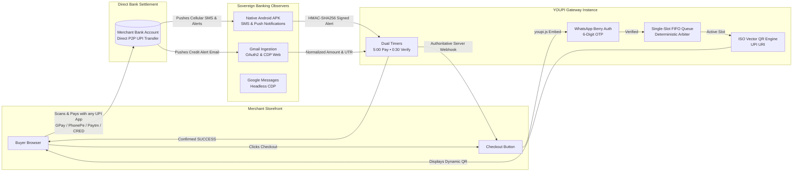

<div align="center">

```
██╗   ██╗ ██████╗ ██╗   ██╗██████╗ ██╗    ██████╗  ██████╗
╚██╗ ██╔╝██╔═══██╗██║   ██║██╔══██╗██║    ██╔══██╗██╔════╝
 ╚████╔╝ ██║   ██║██║   ██║██████╔╝██║    ██████╔╝██║  ███╗
  ╚██╔╝  ██║   ██║██║   ██║██╔═══╝ ██║    ██╔═══╝ ██║   ██║
   ██║   ╚██████╔╝╚██████╔╝██║     ██║    ██║     ╚██████╔╝
   ╚═╝    ╚═════╝  ╚═════╝ ╚═╝     ╚═╝    ╚═╝      ╚═════╝
```

# YOUPI PG V2

### A Self-Hosted UPI Payment Gateway for Merchants

**Originally created by [Gaurav](https://github.com/gxurav1710). The project is now maintained by [Zenuxs](https://zenuxs.in).**
**0% Gateway Fees • Direct-to-Bank Settlement • WhatsApp Pre-Checkout OTP • Bank SMS & Gmail Observers**

> [!IMPORTANT]
>
> ## Research Project — Experimental Use Only
>
> **YOUPI PG V2 is an independent, experimental research and learning project. It is not represented as a certified, bank-approved, NPCI-approved, audited, or production-ready payment gateway.** It is published primarily for external developers to study, test, review, and contribute to.
>
> - **Appropriate scope:** local development, test environments, demos, learning, and carefully controlled experiments. Small projects or early-stage businesses may evaluate it only after independently assessing the risks and their legal/compliance obligations.
> - **Not for critical payments:** do not rely on it for essential, high-value, high-volume, time-sensitive, or business-critical transactions. Do not use it as the sole source of truth for payment confirmation.
> - **Conservative project testing limit:** for experiments, keep usage to **no more than 20 payment attempts/transactions per day per receiving account** unless you have verified the applicable bank, UPI app, and current NPCI rules and obtained any required approvals. This is a conservative project guideline, **not a claim that NPCI imposes a universal 20-transaction daily limit on every UPI account or merchant**. Applicable limits vary by transaction type, bank, app, and risk controls.
> - **No official affiliation:** this repository is not affiliated with, endorsed by, or sponsored by NPCI, RBI, any bank, or any UPI app.
> - **No compliance guarantee:** using this software does not itself authorise you to operate a payment aggregator, payment system, or other regulated service. Before accepting payments from customers or serving third-party merchants, seek qualified legal/compliance advice and confirm requirements with your bank/acquirer and the relevant authorities.
> - **Use test data where possible:** never commit bank alerts, customer information, OTPs, access tokens, API keys, webhook secrets, or other credentials. Use isolated test accounts and rotate any secret that may have been exposed.
> - **Verify every payment independently:** browser callbacks, screenshots, SMS/email parsing, and this software's status are not by themselves conclusive proof of settlement. Reconcile against the bank's official records and handle duplicates, delayed alerts, refunds, disputes, and failed payments safely.
> - **No warranty:** the software is provided for research and experimentation, without guarantees of accuracy, availability, security, compliance, or suitability for a particular purpose. You are responsible for reviewing the code and deciding whether and how to use it.
>
> Read the applicable bank terms and current official UPI requirements before any real-money use. See the [NPCI UPI FAQ](https://www.npci.org.in/what-we-do/upi/faqs) for merchant onboarding context. This notice is informational and is not legal advice.

<br/>

[](https://nodejs.org)
[](#)
[](#)
[](#)
[](#)
[](#)
[](#)
[](#)

<br/>

<p align="center">
  <a href="#-live-product-demos">Live Demos</a> •
  <a href="#-the-problem-vs-the-youpi-solution">Why YOUPI?</a> •
  <a href="#-architecture-at-a-glance">Architecture</a> •
  <a href="#-key-features--superpowers">Superpowers</a> •
  <a href="#-quickstart-in-60-seconds">Quickstart</a> •
  <a href="#-universal-merchant-integration">Merchant Integration</a> •
  <a href="#-tri-channel-observation-mesh">Banking Observers</a> •
  <a href="#-port-topology">Port Topology</a> •
  <a href="#-documentation-hub">Docs</a>
</p>

---

</div>

<br/>

## Live Product Demos

See **YOUPI PG V2** live in action across Desktop and Mobile checkout flows:

|                                                                                                                                              Desktop Modal Flow                                                                                                                                               |                                                                                                                  Mobile Drawer & App Switcher                                                                                                                   |
| :-----------------------------------------------------------------------------------------------------------------------------------------------------------------------------------------------------------------------------------------------------------------------------------------------------------: | :-------------------------------------------------------------------------------------------------------------------------------------------------------------------------------------------------------------------------------------------------------------: |
|                                                        <br/><sub>_Full end-to-end checkout: One-script modal, WhatsApp OTP, dynamic vector QR & bank observation._</sub>                                                        |                                    <br/><sub>_Ultra-responsive bottom drawer with 1-tap deep-link intent for GPay, PhonePe, Paytm & CRED._</sub>                                     |
| • **Zero-JS One-Script Trigger**: Auto-binds to `[data-youpi-pay]`<br/>• **WhatsApp Pre-Checkout OTP**: Real-time 6-digit phone verification<br/>• **Dynamic Vector SVG QR**: Pure vector QR code with dual timers<br/>• **Experimental observer-based payment detection**: Instant credit via bank SMS/Gmail | • **Responsive Bottom Drawer**: Native app-feel mobile UI<br/>• **Direct UPI App Deep-Linking**: GPay, PhonePe, Paytm, CRED<br/>• **Real-Time Payment Polling**: Instant status reflection<br/>• **Counter Desk Modalities**: Configurable Cash & Card fallback |

<br/>

> **High-Definition 120FPS Raw Recordings**: [assets/Desktop.mp4](assets/Desktop.mp4) • [assets/Mobile.mp4](assets/Mobile.mp4)

<br/>

---

## Overview

Traditional payment gateways (Razorpay, Cashfree, PayU, Stripe) lock your revenue into high fees, multi-day settlement delays, and sudden compliance freezes:

| Comparison Metric               | Traditional Aggregators (Razorpay / Cashfree)      | YOUPI PG (Self-Hosted Sovereign)                                                                                |
| :------------------------------ | :------------------------------------------------- | :-------------------------------------------------------------------------------------------------------------- |
| **Transaction Fee**             | **2.0% – 3.0% + 18% GST** per transaction          | **0.0% (Zero Fees Forever)**                                                                                    |
| **Settlement Speed**            | **T+2 to T+3 Business Days** (Holdbacks)           | **Direct transfer; timing and availability depend on the bank and UPI rails**                                   |
| **Account / Service Risk**      | Depends on provider, bank, and circumstances       | **Not eliminated**; banks can still restrict accounts and this project has no guarantee against holds or review |
| **Customer Authentication**     | SMS OTP (Costly SMS gateway bills, phone spoofing) | **WhatsApp OTP** (Zero spoofing, verified mobile)                                                               |
| **Payment Verification**        | Aggregator proprietary webhooks                    | **Bank SMS & Gmail Alerts** parsed in real time                                                                 |
| **Queue & Mismatch Prevention** | Aggregator pooled virtual accounts                 | **Invariant Single-Slot FIFO UPI Queue**                                                                        |
| **Branding Control**            | "Secured by Razorpay" badges mandatory             | **100% White-Label** (Your brand, your domain, zero mentions)                                                   |
| **Offline Retail Till Desk**    | Expensive add-ons / dedicated POS hardware         | **Built-in POS Cash & Card at Till Billing Mode**                                                               |
| **Deployment Simplicity**       | Proprietary SaaS lock-in                           | **Native Node.js host process** (Zero Docker mandatory)                                                         |

<br/>

---

## Architecture at a Glance

YOUPI PG is designed to use standard Indian personal or business UPI receiving accounts for payment collection by coupling **pure vector SVG QR codes** with an **automated multi-channel banking observation mesh**.



<br/>

---

## Key Features

### 1. No Gateway Fee in the Self-Hosted Model (Not a Reliability or Compliance Guarantee)

Every rupee paid goes straight from your customer's bank account to your bank account via standard NPCI UPI rails. This design does not itself provide regulated payment aggregation or guarantee uninterrupted access to a bank account. Confirm your intended use with your bank and qualified advisers.

### 2. WhatsApp Pre-Checkout Authentication (Berry Protocol)

No more fake orders, bot spam, or fraudulent phone numbers. Before a customer can enter the checkout queue, the gateway delivers a cryptographically random 6-digit OTP directly to their WhatsApp app using the embedded Baileys/Berry Protocol socket. Verified customer profiles are remembered in browser `localStorage`.

### 3. Deterministic Single-Slot FIFO Queue Engine

Because standard UPI alerts do not carry arbitrary merchant metadata, multiple concurrent transactions with identical amounts could create attribution confusion. YOUPI PG solves this with a mathematical invariant:

- **Only ONE customer can pay on a VPA at a time.**
- Other buyers wait in a database-backed FIFO queue with live position streaming.
- This queue design is intended to reduce ambiguity when matching incoming payments.

### 4. Native Android Observer APK (`com.youpi.observer`)

A lightweight, battery-optimized Android foreground service that captures:

- Cellular banking SMS (`android.provider.Telephony.SMS_RECEIVED`).
- Real-time bank push notifications via `NotificationListenerService`.
- Enrolls securely via ephemeral QR code and signs all observation payloads with **HMAC-SHA256**.

### 5. Automated Gmail & Google Messages Ingestion

Dual backup observation channels:

- **Gmail Observer (Port 6003):** Polls Google Cloud OAuth2 API or automated headless Chrome CDP inbox monitoring.
- **SMS Observer (Port 6002):** Connects to Google Messages for Web via Chrome DevTools Protocol (CDP).

### 6. Dual Operational Modalities

- **Online Selling Mode:** UPI Vector QR + Cash on Delivery (COD) with customer pre-purchase verification and decoupled address lifecycle.
- **Offline Store Counter Mode:** Designed for physical retail stores. Supports UPI QR, Cash at Till (`CASH_COUNTER`), and Card at POS Terminal (`CARD_COUNTER`) with an interactive real-time cashier till dock and instant SSE customer approval.

### 7. White-Label Configuration

Rebrand the checkout portal completely through environment variables or the Merchant Admin Panel:

- **Global Environment Variables (`.env`)**: Configure gateway-wide defaults via `DEFAULT_APP_NAME`, `DEFAULT_PRIMARY_COLOR`, `DEFAULT_SUPPORT_EMAIL`, `DEFAULT_SUPPORT_PHONE`, `DEFAULT_LOGO_URL`, `DEFAULT_FOOTER_GUARANTEE`, and `WHATSAPP_SENDER_NAME`.
- **Per-Merchant Admin Customizer**: Override app name, logo URL, color theme, and custom instructions live from the admin dashboard without server restarts.
- **Custom domain binding**: Dynamic multi-subdomain routing via Cloudflare Tunnels (`pay.yourbrand.com`).
- **Complete white-labeling**: `DEFAULT_HIDE_POWERED_BY=true` completely eliminates any default platform attribution.

### 8. 5 Standardized Merchant Outcome Pages

The application includes the following customer outcome pages:

- `/order-success` — Payment verified by observers, order marked paid and provisioned.
- `/order-failed` — Verification timed out, reassuring customer no money was lost.
- `/order-suspicious` — Flagged by fraud heuristics, held for manual compliance review.
- `/order-expired` — 5-minute session elapsed, slot released for queued customers.
- `/order-cancelled` — Customer cancelled checkout session.

<br/>

---

## Research Scope, Usage Limits & Safety

This repository is intended for external research, education, code review, prototyping, and controlled experiments. It may be useful for developers exploring payment-flow UX or building a small demo, but it should not be treated as a substitute for a bank/acquirer integration or a professionally reviewed payment service.

### Suggested limits for experiments

- Keep the project to **20 or fewer payment attempts/transactions per day per receiving account** as a conservative project-level testing limit.
- This is **not an official universal NPCI daily cap**. UPI limits depend on transaction category and may also be affected by the bank, UPI application, account type, and risk controls. Check current official rules before use.
- Use low-value transactions only when real-money testing is necessary, and obtain the account holder's permission.
- Do not use this experimental setup to collect payments on behalf of unrelated merchants, pool or route funds, or represent the software as an authorised payment aggregator.
- Do not use it for production checkout until you have completed an independent security review, tested failure and refund paths, established reconciliation and customer-support procedures, and confirmed all applicable legal, contractual, bank, and regulatory requirements.

### Known design risks to evaluate

- **Bank alert parsing can be wrong or delayed.** SMS, notification, and email formats can change, alerts may be duplicated or missing, and messages can be spoofed or misinterpreted.
- **Amount matching is not a complete payment identity check.** Equal amounts, delayed notifications, and replayed events can cause a payment to be attributed to the wrong order.
- **A webhook signature does not prove funds settled.** It only authenticates a message relative to a secret and implementation; merchant systems must still validate event freshness, replay protection, amount, order state, and reconciliation.
- **Secrets and personal data need protection.** Restrict access to bank-connected email, Android observer permissions, logs, databases, backups, and environment files. Do not store more customer data than necessary.
- **Operational safeguards are required.** Add rate limits, access controls, audit logs, backups, monitoring, incident response, refund/dispute handling, and manual reconciliation before considering any real-money deployment.

### Before using with real customers

1. Review the full source code and threat model; do not assume passing tests mean the system is secure.
2. Confirm the receiving account and intended merchant activity are permitted by the bank and applicable UPI terms.
3. Get qualified advice on whether your specific business model triggers payment-system, payment-aggregator, consumer-protection, privacy, tax, or other obligations.
4. Test duplicate notifications, wrong amounts, expired orders, concurrent orders, delayed settlement, refunds, disputes, and service outages.
5. Keep an auditable reconciliation process and a human-reviewed fallback for ambiguous payments.

This section is a practical project warning, not a certification, compliance checklist, or legal opinion.

---

## Quickstart in 60 Seconds

### Prerequisites

- **Node.js `>= 22.13.0` LTS** (Recommended: Node 24 LTS, `node -v`) for native `node:sqlite` (`DatabaseSync`) engine.
  `node:sqlite` was added in Node 22.5.0 but only unflagged in **22.13.0**, so 22.5.0–22.12.x cannot run this project without `--experimental-sqlite`.
- Standard Linux, macOS, or Windows host
- _External database services (PostgreSQL/Redis) are completely optional!_

> **Note:** Containerisation is not included in this repository yet — there is no `Dockerfile` or
> `docker-compose.yml`. Run the services on a native Node.js host as described below.

### Native Host Quickstart

#### 1. Clone & Install Dependencies

Standard `npm install` works out-of-the-box across all packages and apps without any protocol issues:

```bash
git clone https://github.com/youpi-pg/YouPI-PG.git youpi-pg
cd youpi-pg
npm install
```

#### 2. Configure Environment

```bash
cp .env.example .env
```

_(The default `.env` is pre-configured for localhost out of the box)._

### 3. Start the Services

On first launch, YOUPI PG automatically provisions `data/youpi_pg.sqlite`, creates the directory if missing, and executes idempotent migrations and baseline seeds. No manual database setup is required:

```bash
npm run dev
# or
npm start
```

The services can then be accessed at the following local addresses:

- **Control Center Supervisor:** [`http://localhost:8090`](http://localhost:8090)
- **Merchant Admin Panel:** [`http://localhost:6001`](http://localhost:6001)
- **YOUPI Showcase Demo Store:** [`http://localhost:5000`](http://localhost:5000)
- **Payment REST API:** [`http://localhost:6100`](http://localhost:6100)
- **Customer Checkout Portal:** [`http://localhost:7000`](http://localhost:7000)

### 4. Run the Full Regression Test Suite

Verify all **31 test suites** across packages, apps, and chaos harnesses:

```bash
npm test
```

```text
============================================================
 YOUPI PG V2 — FULL REGRESSION TEST RUNNER
Running 31 curated test suites...
============================================================
[1/31] Testing packages/common/src/__tests__/common.test.js...  PASS (0.22s)
...
[31/31] Testing scripts/production-infrastructure.test.js...  PASS (0.17s)
============================================================
 ALL 31 TEST SUITES PASSED CLEANLY (Total: 17.68s)
============================================================
```

<br/>

---

## Universal Merchant Integration

YOUPI PG can be integrated into a website, web application, or e-commerce store using the following steps.

### Step 1: Add the Universal Script to your `<head>`

```html
<!-- Official YOUPI PG Universal Integration Script -->
<script
  src="https://pay.yourdomain.com/youpi.js"
  data-youpi-key="YOUR_MERCHANT_PUBLIC_KEY"
  data-currency="INR"
></script>
```

### Step 2: Declarative Button (Zero JavaScript Required!)

Add `data-youpi-pay` attributes to any existing HTML button:

```html
<button
  data-youpi-pay
  data-order-id="ORDER-1001"
  data-amount="499.00"
  data-currency="INR"
>
  Buy Now with YOUPI PG
</button>
```

_The script automatically intercepts the click, opens a centered desktop modal (or mobile slide-up bottom sheet), and launches the checkout session!_

### Step 3: Programmatic API (For React, Vue, Next.js, Nuxt)

```javascript
window.Youpi.pay({
  order_id: "ORDER-1001",
  amount: 499.0,
  currency: "INR",
  name: "Acme Digital Store",
  description: "Pro Subscription Top-Up",
  handler: function (response) {
    // response: { status: 'SUCCESS', order_id, amount_received, utr }
    console.log(`Payment confirmed! UTR: ${response.utr}`);
    window.location.href = `/order-success?order_id=${response.order_id}&utr=${response.utr}`;
  },
  onClose: function () {
    console.log("Customer closed payment modal");
  },
});
```

### Step 4: Authoritative Server-to-Server Webhook Verification

> **CRITICAL SECURITY RULE:** Never fulfill orders based solely on frontend browser events. Always verify the backend HMAC-SHA256 signature! Consumers **MUST** compute the HMAC over the raw, unparsed request bytes before any JSON parsing.

#### Webhook Contract:

- **Header**: `X-Gateway-Signature: sha256=<64_char_hex_hash>` — `HMAC-SHA256(webhookSecret, rawRequestBody)`
- **Additional Headers**:
  - `X-Gateway-Event: SUCCESS`
  - `X-Gateway-Delivery-Id: <uuid>` — stable across retries; use it to deduplicate
  - `X-Gateway-Timestamp: <timestamp_ms>` — the time the delivery was FIRST signed
  - `X-Gateway-Signature-V2: sha256=<64_char_hex_hash>` — `HMAC-SHA256(webhookSecret, "<timestamp_ms>.<rawRequestBody>")`, binds the timestamp into the signature
- **Payload Fields**:
  - `event`: `'SUCCESS'`
  - `orderId`: Merchant order ID (string)
  - `amount`: Formatted amount in Rupees, e.g. `'499.00'`
  - `amountPaise`: Integer amount in Paise, e.g. `49900`
  - `utr`: 12-digit bank reference number
  - `paymentId`: Unique gateway payment session UUID
  - `deliveryId`: UUID of this delivery (matches the `X-Gateway-Delivery-Id` header)
  - `timestamp`: Epoch milliseconds the delivery was first signed (matches `X-Gateway-Timestamp`)
  - `verificationTag`, `verificationLevel`: Verification provenance
- **Retries**: a failed delivery is retried with backoff up to 1 hour later. The body is
  resent byte for byte, so `X-Gateway-Timestamp` and `X-Gateway-Delivery-Id` still describe
  the ORIGINAL delivery. Any freshness window you enforce must therefore cover the gateway's
  retry schedule; deduplicate on `deliveryId` rather than on the timestamp.
- **Amount matching**: reusing an `orderId` with a different amount is rejected with
  `409 ORDER_AMOUNT_MISMATCH`.

#### Polyglot Webhook Verification Snippets:

##### 1. Node.js (Express)

```javascript
import crypto from "node:crypto";

app.post(
  "/api/youpi-webhook",
  express.raw({ type: "application/json" }),
  (req, res) => {
    const signature = req.headers["x-gateway-signature"] || "";
    const secret = process.env.YOUPI_WEBHOOK_SECRET;
    const expected =
      "sha256=" +
      crypto.createHmac("sha256", secret).update(req.body).digest("hex");

    if (
      signature.length !== expected.length ||
      !crypto.timingSafeEqual(Buffer.from(signature), Buffer.from(expected))
    ) {
      return res.status(401).json({ error: "Invalid webhook signature" });
    }

    const payload = JSON.parse(req.body.toString("utf8"));
    if (payload.event === "SUCCESS") {
      // Fulfill order: payload.orderId, payload.utr, payload.amount, payload.amountPaise
    }
    res.status(200).json({ received: true });
  },
);
```

##### 2. Python (FastAPI)

```python
import hmac, hashlib, json
from fastapi import FastAPI, Request, HTTPException

app = FastAPI()

@app.post("/api/youpi-webhook")
async def youpi_webhook(request: Request):
    raw_body = await request.body()
    signature = request.headers.get("X-Gateway-Signature", "")
    secret = request.app.state.webhook_secret.encode("utf-8")

    expected = "sha256=" + hmac.new(secret, raw_body, hashlib.sha256).hexdigest()
    if not hmac.compare_digest(signature, expected):
        raise HTTPException(status_code=401, detail="Invalid webhook signature")

    payload = json.loads(raw_body.decode("utf-8"))
    if payload.get("event") == "SUCCESS":
        # Fulfill order: payload["orderId"], payload["utr"], payload["amount"]
        pass
    return {"received": True}
```

##### 3. PHP

```php
<?php
$rawPayload = file_get_contents('php://input');
$signature = $_SERVER['HTTP_X_GATEWAY_SIGNATURE'] ?? '';
$secret = getenv('YOUPI_WEBHOOK_SECRET');

$expected = 'sha256=' . hash_hmac('sha256', $rawPayload, $secret);

if (!hash_equals($expected, $signature)) {
    http_response_code(401);
    exit(json_encode(['error' => 'Invalid webhook signature']));
}

$payload = json_decode($rawPayload, true);
if (($payload['event'] ?? '') === 'SUCCESS') {
    // Fulfill order: $payload['orderId'], $payload['utr'], $payload['amount']
}

http_response_code(200);
echo json_encode(['received' => true]);
?>
```

##### 4. Go (`net/http`)

```go
package main

import (
	"crypto/hmac"
	"crypto/sha256"
	"encoding/hex"
	"encoding/json"
	"io"
	"net/http"
	"os"
)

func youpiWebhookHandler(w http.ResponseWriter, r *http.Request) {
	rawBody, err := io.ReadAll(r.Body)
	if err != nil {
		http.Error(w, "Cannot read body", http.StatusBadRequest)
		return
	}
	defer r.Body.Close()

	signature := r.Header.Get("X-Gateway-Signature")
	secret := []byte(os.Getenv("YOUPI_WEBHOOK_SECRET"))

	mac := hmac.New(sha256.New, secret)
	mac.Write(rawBody)
	expected := "sha256=" + hex.EncodeToString(mac.Sum(nil))

	if !hmac.Equal([]byte(signature), []byte(expected)) {
		http.Error(w, "Invalid webhook signature", http.StatusUnauthorized)
		return
	}

	var payload struct {
		Event       string `json:"event"`
		OrderId     string `json:"orderId"`
		UTR         string `json:"utr"`
		Amount      string `json:"amount"`
		AmountPaise int64  `json:"amountPaise"`
	}
	if err := json.Unmarshal(rawBody, &payload); err == nil && payload.Event == "SUCCESS" {
		// Fulfill order: payload.OrderId, payload.UTR, payload.Amount
	}

	w.WriteHeader(http.StatusOK)
	w.Write([]byte(`{"received":true}`))
}
```

<br/>

---

## Tri-Channel Observation Mesh

YOUPI PG confirms payments without expensive commercial banking APIs using a triple-layer observation pipeline:

```text
              CUSTOMER SCANS & PAYS VIA UPI
                           │
                           ▼
                 RECEIVING BANK ACCOUNT
                           │
        ┌──────────────────┼──────────────────┐
        ▼                  ▼                  ▼
┌───────────────┐  ┌───────────────┐  ┌───────────────┐
│  CELLULAR SMS │  │   BANK PUSH   │  │  GMAIL CREDIT │
│  ALERT ON SIM │  │ NOTIFICATION  │  │  ALERT EMAIL  │
└───────┬───────┘  └───────┬───────┘  └───────┬───────┘
        │                  │                  │
        ▼                  ▼                  │
┌──────────────────────────────────┐          │
│    NATIVE ANDROID OBSERVER APK   │          │
│  com.youpi.observer (Foreground) │          │
│     HMAC-SHA256 Signed Payload   │          │
└─────────────────┬────────────────┘          │
                  │                           ▼
                  │                 ┌───────────────────┐
                  │                 │   GMAIL OBSERVER  │
                  │                 │ Google Cloud API  │
                  │                 └─────────┬─────────┘
                  │                           │
                  └─────────────┬─────────────┘
                                ▼
                   PAYMENT CORE REST ENGINE
               Exact Amount & UTR Normalization
                                │
                                ▼
                       SUCCESS CONFIRMED
```

1. **Android Observer App:** Install [`apps/android-observer-app/youpi-sms-gateway.apk`](apps/android-observer-app/youpi-sms-gateway.apk) (Certified SHA-256: `959218223e75da4784744c16afaf7bc121cff377dff04f041875237042f51601`) on any secondary Android smartphone with the receiving bank SIM. Scan the pairing QR code in Merchant Admin to establish an encrypted HMAC link.
2. **Gmail Observer:** Connect your bank-registered Google account using standard OAuth2 credentials.
   <details>
   <summary><b>🔍 View Verified Indian Bank Domains & RBI <code>.bank.in</code> Registry</b></summary>

   > Supports both modern RBI-mandated sovereign `.bank.in` / `.fin.in` spaces (`sbi.bank.in`, `hdfcbank.bank.in`, `icici.bank.in`, `axis.bank.in`, `kotak.bank.in`, `pnb.bank.in`, `bankofbaroda.bank.in`, etc.) and verified legacy notification channels with full subdomain routing (`alerts.hdfcbank.net`, `custalert.icicibank.com`, `alerts.sbi.co.in`, `kotak.com`, `canarabank.com`, etc.). See [docs/OBSERVERS_SETUP.md](docs/OBSERVERS_SETUP.md) for full DNS / MX verified topology.

   </details>

3. **Google Messages Web Observer:** Pairs via headless Chrome DevTools Protocol to observe cellular SMS through Google Messages Web.

<br/>

---

## Port Topology & Microservices Map

| Service             |  Port  | Directory                                                | Entrypoint     | Responsibility                                                      |
| :------------------ | :----: | :------------------------------------------------------- | :------------- | :------------------------------------------------------------------ |
| **Payment API**     | `6100` | [`apps/payment-api`](apps/payment-api)                   | `src/index.js` | Core REST API, state machine, DB transactions & SSE stream          |
| **Checkout Portal** | `7000` | [`apps/checkout-portal`](apps/checkout-portal)           | `src/index.js` | Customer iframe checkout, dynamic vector QR, SDK bundle             |
| **Merchant Admin**  | `6001` | [`apps/merchant-admin`](apps/merchant-admin)             | `src/index.js` | Operations panel, till billing desk, branding customizer            |
| **Showcase Store**  | `5000` | [`apps/coin-wallet-store`](apps/coin-wallet-store)       | `src/index.js` | Reference enterprise merchant PDP, 5 outcome demonstrations         |
| **Control Center**  | `8090` | [`apps/control-center`](apps/control-center)             | `src/index.js` | Process supervisor for starting, stopping, and logging all services |
| **SMS Observer**    | `6002` | [`apps/sms-observer`](apps/sms-observer)                 | `src/index.js` | Google Messages Web automation via Chrome CDP                       |
| **Gmail Observer**  | `6003` | [`apps/gmail-observer`](apps/gmail-observer)             | `src/index.js` | Gmail Web CDP automation & Google OAuth2 poller                     |
| **Android APK**     |  N/A   | [`apps/android-observer-app`](apps/android-observer-app) | Android OS     | Intercepts cellular banking SMS and notifications                   |

<br/>

---

## Security & Reliability Architecture

- **64-Bit Integer Minor Units (Paise):** Financial values are strictly represented as integers (`49900` paise = ₹499.00). Floating-point rounding drift is mathematically impossible.
- **Server-Authoritative Timers:** Timers are calculated strictly from SQLite state timestamps. Client-side browser tampering cannot manipulate countdowns.
- **Anti-Replay Observation Protection:** Android observer payloads require HMAC signatures with timestamp drift verification ($< 60$ seconds).
- **Hardware & Browser Fingerprinting:** The implementation may collect device/browser signals. Treat these as fallible risk signals, not reliable identity proof; review privacy, retention, and appeal requirements before use.
- **Write-Ahead Logging (WAL):** SQLite operates with `PRAGMA journal_mode = WAL; PRAGMA foreign_keys = ON;`, ensuring crash safety and concurrent read performance.

<br/>

---

## Documentation Hub

Deep-dive engineering manuals and operational runbooks are available in the [`/docs`](docs) directory:

| Document                                                                   | Description                                                |
| :------------------------------------------------------------------------- | :--------------------------------------------------------- |
| [`ARCHITECTURE.md`](ARCHITECTURE.md)                                       | **Canonical System Architecture & Engineering Blueprint**  |
| [`docs/INSTALLATION.md`](docs/INSTALLATION.md)                             | Host installation, prerequisites & environment setup       |
| [`docs/CONFIGURATION.md`](docs/CONFIGURATION.md)                           | Environment configuration variables & secret management    |
| [`docs/ANDROID_MOBILE_APP.md`](docs/ANDROID_MOBILE_APP.md)                 | Native Android Kotlin Observer APK guide & permissions     |
| [`docs/OBSERVERS_SETUP.md`](docs/OBSERVERS_SETUP.md)                       | Complete setup for Gmail, Google Messages & Android        |
| [`docs/MERCHANT_INTEGRATION.md`](docs/MERCHANT_INTEGRATION.md)             | Full developer integration guide, SDK methods & webhooks   |
| [`docs/WHITE_LABEL.md`](docs/WHITE_LABEL.md)                               | White-label branding customizer, domains & Cloudflare      |
| [`docs/OPERATIONS_TROUBLESHOOTING.md`](docs/OPERATIONS_TROUBLESHOOTING.md) | Production operations, logs, diagnostics & troubleshooting |
| [`openapi.yaml`](openapi.yaml)                                             | Official OpenAPI 3.0 REST API specification                |

<br/>

---

## License

See [`LICENSE`](LICENSE) for the actual license terms. A license to use the code does not imply regulatory approval, bank approval, security certification, or permission to operate a regulated payment service.

<br/>

<div align="center">

### YOUPI PG

**Self-hosted payment infrastructure with direct UPI settlement.**

⭐ **Contributions and feedback are welcome.**

</div>
